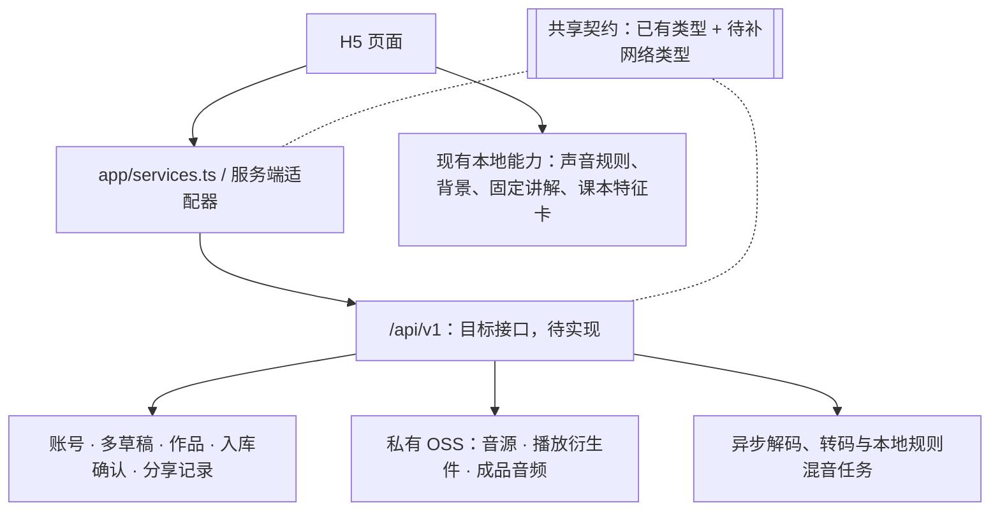

# 万物声谱 v2 接口协议

v0.6 · 2026-10-25 修订 · 原稿：2026-10-24 / Haha Guo

## 概述

本协议面向 [voice_atalas_v2](https://github.com/guohaha777/voice_atalas_v2)（万物声谱正式 H5）。v0.6 根据 2026-10-25 已确认的首版范围修订，替代 v0.5 中关于短信登录、单一草稿、平台审核和首版 AI 功能的约定。

**本文是目标协议，不是实现完成说明。本次只修订文档，没有同步修改前端契约、业务代码或部署。** 原稿参考代码提交 `f8a2d56`；现有代码的 11 个前端端口、6 个数据契约和旧 24 个预留接口是对接基础，不能视为已经符合本版约定。

- **已确认需求：** 下一节的首版范围，以本轮产品确认结果为准。
- **建议技术设计：** 本文后续新增的路径、字段、状态和默认行为，是供研发实现与联调的建议，不冒充已实现接口；需同步到 `packages/contracts` 后再验收。
- **前端如何调用：** 继续通过 `apps/web/src/app/services.ts` 选择实现，尽量复用页面。注册登录、多草稿入口、入库确认和公开分享页仍可能需要补充，不能承诺只换一个文件。
- **数据格式：** 复用 `packages/contracts`（`@wanwu-v2/contracts`）已有声音、摆放、作品类型；新增网络封装和权限字段需要补契约。旧类型与本版需求冲突时，先对齐契约，再联调。
- **文档边界：** 本协议说明接口与对接要求，不重定页面视觉或音乐听感，也不表示业务开发、云服务开通或部署已经完成。

## 首版范围（已确认）

| 项 | 首版约定 |
| --- | --- |
| 形态 | 响应式 H5，暂不做微信小程序 |
| 账号 | 受邀老师凭邀请码注册；之后用自己的账号和密码登录，不接短信登录，不开放公众自由注册 |
| 孩子与访客 | 孩子不单独注册，可用昵称；访客可体验本地创作，不提供未登录的云端保存或跨设备同步 |
| 多草稿 | 同一老师账号可有多份独立草稿，分别保存、继续编辑，支持不同编辑会话处理不同作品 |
| 作品归属 | 作品归老师账号；首版不建立学校、班级或地域权限空间 |
| 作品能力 | 云端保存、打开、改名、删除，并生成书架和分享播放用的成品音频；成品合成属于首版，不因 AI 暂缓而取消 |
| 素材库 | 个人素材库，以及所有受邀老师共用的一个共享素材库；不按学校、班级、地域分库 |
| 入库确认 | 两类库都由受邀老师试听并确认后入库；后台记录确认人、时间和音频版本。不设平台逐条审核岗，不接付费内容审核服务 |
| 上传与入库 | 录音或上传不等于入库；只用于当前作品的临时音源，不自动出现在个人库或共享库 |
| 素材共享 | 共享素材仅供登录的受邀老师查询和使用，不开放公众投稿或匿名访问共享库 |
| 作品分享 | 老师确认发布即可生成链接；未登录的人也能通过链接访问，不做平台逐首审核 |
| 本地音乐能力 | 保留本地规则背景、现有乐器、预设或自填心情、固定讲解文案和已有课本特征卡 |
| 延后能力 | AI 音频背景、AI 音符背景、AI 心情识别、AI 讲解润色、教学音乐自动分析，以及学校／班级／地域分库 |

“老师确认制”是老师对内容的试听与声明，不是自动内容识别，也不等同于独立平台审核。格式、大小、时长、解码等技术检查照常执行，但不能描述成“已通过儿童适宜内容检测”。

原始音频保持不可覆盖；声音塑形、节选和编排保存参数或生成衍生件，不改写原件。共享和发布权限由服务端校验，不能信任浏览器自行声明的账号、角色或审核结果。



前端仍有内存 mock 和如实的离线实现；后端接入后逐项替换。不能把 mock 的 `session` 保存结果显示成已云端保存，也不宣称已实现 PWA、离线同步或访客刷新恢复。

## 通用约定（建议技术设计）

接口在 `/api/v1` 下，收发 JSON（UTF-8），字段名用 camelCase。二进制音频由浏览器直传对象存储，不放进这些 JSON 请求。

| 项 | 约定 |
| --- | --- |
| 同源入口 | 前端可继续托管 Netlify，API 代理到独立后端；API 路由优先于 SPA 回落。正式入口使用 HTTPS，API 请求不能返回 `index.html` |
| 会话 | HttpOnly、Secure、SameSite=Lax Cookie；令牌不放浏览器可读存储。状态变更请求做来源／CSRF 校验，不信任客户端伪造的身份头 |
| 角色 | 有效受邀账号为老师；管理员负责邀请、账号恢复和异常素材停用，不承担逐条音源审核。注册请求不能指定管理员角色 |
| 私有权限 | 私有作品、个人素材仅所属老师可访问；共享素材供有效老师账号使用。公开分享链接不开放账号接口或整个素材库 |
| 格式版本 | `version: "sound-v1" / "arrangement-v1" / "work-v1"` 表示数据格式版本，不表示某次保存的修订号 |
| 并发修订 | 建议服务端另设单调递增的 `revision`，返回强 ETag；更新携带原样 `If-Match`。时间字段不承担唯一修订标识 |
| 规则与渲染版本 | 保存 `RuleVersions`（analysis / shaping / background / mix）；成品另关联渲染器／音色版本和实际音频资产 |
| 时间 | 服务端时刻用 ISO 8601 UTC 字符串；`recordedOn` 为记录人本地日期 `YYYY-MM-DD`。保存和确认时间由服务端生成 |
| 单位 | `Ms` 是毫秒；`seconds` 是秒；`at` 是 0–1 先后位置；音量／accent 为 0–1；MIDI 21–108 |
| 文字 | 沿用现有清洗函数和字符计数，前后端使用一致的长度、空白和占位符规则 |
| 异步处理 | 转码和成品混音区分 queued / processing / ready / failed；任务已提交不等于音频已完成 |
| 重试 | 建草稿、上传完成、入库确认、渲染和发布采用稳定 ID 或幂等键；相同请求重试不能重复建资产或重复发起昂贵任务 |
| 私有播放 | 鉴权后签发短时播放地址并返回过期时间，过期后刷新。存储保持私有，临时签名 URL 不作为资产身份 |
| 未开放 | 明确返回 not-open 或使用现有本地实现，不伪造成功。首版不调用生成式 AI、教学音乐自动分析或第三方付费内容审核服务 |

已有 `parseXxx` / `isXxx` 是校验起点。服务端还需检查真实文件、引用关系、资源归属、数值／列表上限、允许的规则版本等；前端传来的体检结果和 TypeScript 类型都不等于可信事实。

## 首版接口清单（建议，均待实现／联调）

登录、邀请、多草稿和入库确认是新增范围，旧“24 个接口”不再作为完整工作量或验收清单。路径省略 `/api/v1`。

| 模块 | 方法 | 路径 | 用途 | 权限 |
| --- | --- | --- | --- | --- |
| 账号 | POST | `/auth/register` | 邀请码、账号、密码注册 | 有效邀请码 |
| 账号 | POST | `/auth/login` | 账号密码登录并建立会话 | 无需已有会话 |
| 账号 | POST | `/auth/logout` | 撤销当前会话 | 当前会话 |
| 账号 | GET | `/auth/me` | 当前身份与账号状态 | 登录账号 |
| 邀请 | POST | `/admin/invitations` | 创建邀请 | 管理员 |
| 邀请 | GET | `/admin/invitations` | 查看邀请状态 | 管理员 |
| 邀请 | DELETE | `/admin/invitations/{invitationId}` | 撤销未兑换邀请 | 管理员 |
| 草稿 | POST | `/works` | 创建独立草稿，可接收前端稳定 ID | 老师 |
| 草稿／书架 | GET | `/works?owner=me&state=draft` | 查询草稿；state=saved 查询书架 | 所属老师 |
| 作品 | GET | `/works/{workId}` | 读取指定作品快照及关联资源查询地址 | 所属老师 |
| 草稿 | PUT | `/works/{workId}/arrangement` | 保存摆放 | 所属老师 |
| 草稿 | PUT | `/works/{workId}/compose-settings` | 保存背景和课本灵感设置 | 所属老师 |
| 作品 | PUT | `/works/{workId}` | 保存到书架，触发该版本成品任务 | 所属老师 |
| 作品 | PATCH | `/works/{workId}` | 改作品名 | 所属老师 |
| 作品 | DELETE | `/works/{workId}` | 删除自己的作品并撤销分享 | 所属老师 |
| 成品 | GET | `/works/{workId}/render` | 查询指定修订的合成状态和播放信息 | 所属老师 |
| 成品 | POST | `/works/{workId}/render` | 重试失败的成品任务 | 所属老师 |
| 音源 | PUT | `/sources/{sourceId}` | 登记上传意图，获取或续签上传地址 | 老师 |
| 音源 | POST | `/sources/{sourceId}/complete` | 复核上传并处理音频，不自动入库 | 上传老师 |
| 音源 | GET | `/sources/{sourceId}` | 查询处理结果、获取授权播放地址 | 有权使用该音源的老师 |
| 素材库 | GET | `/sources?scope=mine` | 查个人库；scope=teachers 查共享库 | 老师 |
| 素材库 | GET | `/sound-units?scope=mine` | 查声卡；scope=teachers 查共享声卡 | 老师 |
| 素材库 | POST | `/library/entries` | 老师试听确认后加入选定库 | 有权入库的老师 |
| 素材库 | PATCH | `/library/entries/{entryId}` | 修改自己的条目／范围，必要时重新确认 | 所属老师 |
| 素材库 | DELETE | `/library/entries/{entryId}` | 移除条目，保留仍被作品引用的文件 | 所属老师；管理员可停用异常条目 |
| 分享 | POST | `/works/{workId}/share` | 老师确认发布指定作品修订 | 所属老师 |
| 分享 | GET | `/works/{workId}/share` | 查询活动发布、等待成品或撤销状态 | 所属老师 |
| 分享 | DELETE | `/works/{workId}/share` | 撤销该作品的活动分享链接 | 所属老师 |
| 公开访问 | GET | `/shares/{shareToken}` | 已发布作品的只读分享视图 | 持有效链接，无需登录 |

乐器目录、固定语料和课本特征卡可继续随前端发布，不为保留本地能力强制增加后端调用。“再来一首”创建或选择另一份草稿，不删除旧草稿，也不改变其他设备的编辑会话。

## 接口详情

本节新增网络格式需补入契约包，不是现有前端已经支持的格式声明。除注册、登录和公开分享读取外，业务接口需要有效老师会话；管理员接口另校验角色。

### 账号、邀请与恢复

- 注册请求建议为 `{invitationCode, username, password}`；成功后返回最小账号信息并建立会话，不返回密码或长期令牌。
- 邀请兑换与账号创建必须原子完成；建议邀请码单次使用、有有效期、可撤销，服务端只保存摘要。单次使用等默认策略属于技术建议，不是已实现声明。
- 登录请求为 `{username, password}`；邀请码仅用于注册准入，不作为日常登录凭证。
- 密码散列、校验和会话撤销交给成熟认证组件，不自行保存明文密码。具体认证组件、密码策略、用户名规范和会话期限在技术方案阶段确定。
- 首版不接短信／微信，不开放儿童账号或公众自由注册。忘记密码建议管理员核实后协助恢复；具体流程随认证方案设计，不承诺已有邮件／短信找回。
- 管理员邀请接口只返回必要管理信息，不反复展示完整邀请码；真实凭据不进 Git、浏览器包或日志。

### 多草稿、作品与书架

每份草稿有独立 `workId`。一个老师可在多台设备或多个编辑会话中处理不同草稿；当前打开哪份由编辑会话记录，不设置“全账号唯一当前作品”。孩子昵称是作品信息，不是登录身份或权限依据。

1. `POST /works` 创建空草稿，或接收用户确认要导入的本地草稿。前端稳定 ID 的重试需幂等；ID 若属于其他账号，不能覆盖。成功返回 `201`、服务端修订号和 ETag。
2. `GET /works?owner=me&state=draft|saved` 查询草稿或书架，建议响应 `{items, nextCursor}`；列表摘要、排序与分页参数需要补契约。
3. `GET /works/{workId}` 返回指定作品的摆放、设置、保存状态、修订号和关联资源查询地址。成品进度和活动分享状态分别查询 render／share 子资源，由适配器合并为页面视图；不让后台进度变化悄悄改动同一内容快照。
4. 保存摆放与设置使用两个 PUT 子接口，携带 `If-Match`。最多 12 张声音卡、24 个事件；单元／事件 ID 唯一，引用存在，位置、行和节选范围合法。
5. `PUT /works/{workId}` 保存完整作品到书架。请求 `id`、`arrangement.id` 与路径 ID 必须一致；标题 1–16 字。所属账号、服务端时间、成品资产和分享状态不能由浏览器修改。
6. 元数据保存成功不等于成品音频已完成。草稿保存不必每次触发整首混音，正式保存时按内容修订去重生成。
7. 删除作品时撤销分享、移出草稿／书架；音频按引用关系异步回收，不误删其他作品或库条目仍在使用的文件，也不承诺备份立即物理清零。

并发协议示例（建议）：

```http
ETag: "work_8f2c:r7"
If-Match: "work_8f2c:r7"
```

数据库原子比较修订号后更新；版本过旧返回 `412`，需要版本头但缺失时建议返回 `428`。前端保留未保存内容，提供重新加载／另存副本，不能静默覆盖。`updatedAt` 用于显示时间；现有 `SaveResult.version` 的时间字符串假设需要由适配器调整或映射，不能与数据格式 `version` 混用。

ETag 对应明确的资源表示：编辑快照与异步处理／分享状态分开，不能让已改变的响应内容继续使用同一个强 ETag。旧 `SavedWork.share` 的运行状态需要相应拆分或迁移，不直接留在不变的内容快照里。

保存响应示例（新增网络封装，待实现）：

```json
{
  "status": "saved",
  "workId": "work_8f2c",
  "revision": 8,
  "updatedAt": "2026-10-25T08:05:00.000Z",
  "render": {"status": "queued", "jobId": "render_4d9a", "workRevision": 8}
}
```

### 成品音频生成

- 首版使用孩子的声音、摆放、设置与本地规则背景生成成品，不调用 AI 生成服务。现有浏览器能播放，不代表服务端渲染器已实现；此项需单独开发、对照试听验收。
- 任务绑定 `workId + workRevision + RuleVersions + rendererVersion`；较旧任务完成不能覆盖较新修订的成品。
- `GET /works/{workId}/render?revision=8` 查询指定修订，返回 queued / processing / ready / failed。ready 时包含稳定 `audioAssetId`、播放 URL、`expiresAt`、时长和渲染版本。
- `POST /works/{workId}/render` 重试指定修订；相同输入去重，不因刷新或轮询重复混音。
- 任务提交建议快速返回 `202`，前端按 `retryAfterSeconds` 有限轮询；失败保留作品数据，不能显示成作品已丢失。
- 成品作为独立衍生件保存，规则与相应渲染版本可追溯。从第一批需长期保留的作品开始，不在同一规则版本下直接改变听感。

### 录音上传：只登记音源，不自动入库

1. `PUT /sources/{sourceId}` 接收 `{source, analysis?, bytes, checksum}`；ID 为前缀 + UUID。同一 ID 重试必须对应同一文件，不允许借续签换成另一份音频。
2. 服务端检查账号、声明格式、大小上限和来源字段，签发限定对象的上传地址。沿用 `missingProvenance` 的来源要求：非示例音源填写名称、记录人昵称、日期和大致地点。字节上限和允许格式由配置及前后端联调明确，不仅凭 `audio/*` 放行。
3. 建议响应 `{uploadId, method, uploadUrl, requiredHeaders, expiresAt}`。浏览器按指定方法与请求头直传私有 OSS；续签重新调用上传意图接口，不下发长期 AccessKey。
4. `POST /sources/{sourceId}/complete` 带上传 ID／校验信息；服务端核对归属、实际字节、文件指纹、解码后的类型／时长，必要时重算体检并转码。完成请求重试幂等。
5. 未处理完返回 `202` 与 queued / processing；`GET /sources/{sourceId}` 查询 ready / failed 并取得授权播放地址。客户端的 MIME 声明或 SHA 元数据不能单独作为文件已校验的证据。
6. ready 只表示技术处理完成，可用于有权访问的作品；**不表示已入库、做过内容识别或经过平台审核。**

普通音源按 45 秒上限设计，兼容现有录音停止的 500 ms 技术余量，前后端统一实际校验边界。允许的录音／上传格式需覆盖目标浏览器实际编码，并实测 WebM、MP4、OGG 和用户文件处理，不复制与页面能力不符的 MIME 白名单。

原件按稳定资产 ID、对象键和校验指纹标识，不可覆盖；入库确认不能绑定一条会失效的签名 URL。防覆盖、校验、超限处理要在存储与服务端落实，不能仅依赖前端提示。

只用于某首作品的音源可留作作品引用，但不得自动列入个人素材库。首版采用整文件直传与重试；单个预签名 URL 不等同分片续传，真正分片协议如需支持需另行设计。

含本地录音的作品要完成跨设备保存，需先完成相应音源上传与技术处理，再保存稳定资产引用；本机 blob URL 或内存缓冲区不能被当成云端已可恢复的音源。

### 素材入库：老师试听确认

个人库和共享库使用相同确认流程。老师上传、创作时可以试听，但只有主动申请并确认的内容才建立可用库条目。首版不设置“提交后等待平台人员审批”的步骤。

`POST /library/entries` 建议请求：

```json
{
  "sourceId": "source_8f2c",
  "kind": "source",
  "scope": "private",
  "confirmation": {
    "listened": true,
    "suitableForChildren": true,
    "statementVersion": "teacher-confirmation-v1"
  }
}
```

- `scope`：`private` 为个人库，`teachers` 为全体受邀老师共享库，两者都需试听确认。
- `kind`：`source` 为音源条目，`sound-unit` 为声卡条目；后者另带 `unit: SoundUnitDraft`。服务端验证声卡引用，绑定实际音源版本与声卡参数。
- 只有有权入库的老师可操作。建议条目创建者管理自己的条目，原音源仍归上传者；老师可用获授权的共享音源制作自己的声卡并重新确认入库，但不能因此修改或删除他人的原音源／条目。
- 服务端生成 `entryId`，从会话取 `confirmedBy`，用服务端时间写 `confirmedAt`，绑定 `sourceVersion`／校验指纹和确认说明版本。不接受浏览器伪造确认人或时间。
- 确认不完整或文件未 ready 时，不创建可用条目。上传完成接口不能自动补出确认；不返回 machineApproved 等误导状态。
- 修改音频需新建不可变音源并重新确认；变更条目内容或转共享时需重新确认本次内容。确认过个人素材不等于允许自动公开。
- 删除库条目后停止新引用；已有作品中的文件按引用保留策略处理，不能误删他人作品的音频。不是逐条审核的管理员可停用异常条目，具体管理入口待技术设计。

`GET /sources?scope=mine|teachers` 与 `GET /sound-units?scope=mine|teachers` 只列已确认且有效的条目。建议分页响应 `{items, nextCursor}`；音源条目复用 `SourceEntry`，外层补 `entryId`、范围、确认信息与播放过期时间；声卡条目也需关联授权音源。

示例声音继续随网页发布，访客可用，不强制走云端素材接口。旧 `scope=class|school|region|public` 不作为首版开放范围，也不能把 `public` 当成受邀老师共享。

### 作品发布：老师确认，免登录链接访问

- `POST /works/{workId}/share` 建议请求 `{workRevision, confirmation:{listened:true, suitableForChildren:true, statementVersion}}`。服务端核对所属老师、保存修订及成品，记录发布确认。
- 成品 ready 时发布成功，返回 `201`、分享 URL 和已发布修订；不等待平台审核，不返回旧 pending-review 状态。
- 成品仍在生成时建议返回 `202` 和 `pending-render`，只表示等待技术处理。发布意图绑定老师确认的修订，不能自动替换为尚未确认的新草稿。
- `GET /works/{workId}/share` 查询该作品的活动发布；尚未发布时可返回空发布记录，已提交但成品未完成时返回 pending-render，发布后关联 publishedRevision 和分享 URL。状态格式需新增契约，不复用平台审批状态。
- 建议采用发布快照：编辑草稿不自动改链接内容；老师再次确认发布后，才更新活动链接所指的快照。发布历史和撤销策略在技术设计中落实。
- `GET /shares/{shareToken}` 无需登录，只返回该链接已发布的只读视图和成品播放信息。需补公开响应契约，不能直接返回包含私有来源、账号信息或整个素材库权限的管理用 `SavedWork` 响应。
- 分享令牌建议不可枚举；撤销或作品删除后不再签发播放地址。已签出的地址按短时有效期到期；缓存与 URL 期限需和撤销体验一起设计，不承诺已下载副本能收回。
- 默认建议仅通过链接分享，不自动进入公开作品广场。链接分享不使个人素材变成匿名可查询的素材库条目。

临时音源没有加入素材库，不因此阻止老师试听当前作品并确认发布。作品确认与素材入库确认是两个独立动作，不能扩大成“所有录音都要平台审核后才能创作或分享”。

## 数据结构与契约调整

保留已有六类数据契约作为基础；以下区分已有字段与待补网络记录。表中的首版限制需要在共享校验和服务端落地，不能仅保留 TypeScript 声明。

### 声音（sound-v1）

| 类型 | 已有字段 | 约束／本版调整 |
| --- | --- | --- |
| `SoundSource` | id、kind、label、durationMs、mimeType、provenance | kind 为 example / local-recording / local-file / uploaded；uploaded 不等于已入素材库。普通音源上限 45 秒及技术余量 |
| `SourceProvenance` | recordedBy、recordedOn、place、group、provenanceUrl | 可为空；文字字段按既有规则限制。只记昵称和大致地点；group 是采集分组，不是权限班级 |
| `SoundUnitDraft` | version、id、sourceId、name、maker、markerIndex、shape、input、createdAt、analysis? | name ≤12 字，maker ≤6 字或 null；必须能追溯并授权访问引用音源 |
| `ChosenShape` | pitch?、duration?、contour?、intensity?、pattern? | 五项可缺，缺项保持原声，不自动替孩子选中性值 |
| `SoundAnalysis` | rules、durationMs、silent、main、units、kind、unitMs、lengthBand、loudnessDb、peakDb、brightnessHz、band | 固定规则体检，不是内容审核；kind 为 one / series / texture。前端结果仅供参考，服务端校验后再采用 |
| `SourceEntry` | source、url、analysis | 复用播放条目；网络层需补 entryId、范围、确认记录、expiresAt，不把临时 URL 存成资产身份 |

### 摆放与作品（arrangement-v1、work-v1）

| 类型 | 已有字段 | 约束／本版调整 |
| --- | --- | --- |
| `Arrangement` | version、id、units、events、rows、spanSeconds、mood、origin、updatedAt | ≤12 单元、≤24 事件；rows 3–5，spanSeconds 档位 20 / 30 / 45；每份草稿独立，不是全账号唯一 |
| `PlacedEvent` | id、unitId、at、row、clip | at 为 0–1；row 仅管排版，引用存在且 clip 不超出实际音源可用范围 |
| `SourceClip` | startMs、endMs | 整数，长度 ≥200 ms；按既有上限校验并核对源文件真实时长，只引用原件 |
| `MoodChoice` | preset 的 id，或 custom 的 text、nearest | 自填原话 1–12 字；首版不做 AI 识别，nearest 可为 null |
| `ComposeSettings` | background、inspiration | 保留背景开关／音量／乐器和已有课本灵感；首版不生成教学音乐分析引用 |
| `BackgroundLayer` | enabled、instruments、volume | 乐器最多 6 个不重复，音量 0–1；空乐器列表为原始背景，enabled 控制是否静音 |
| `Inspiration` | none / textbook / teaching-music | 首版使用 none 或已有 textbook；teaching-music 为未来兼容，不等于已开放分析能力 |
| `SavedWork` | version、id、title、arrangement、settings、rendering、visibility、share、savedAt | 首版私有管理记录归老师；旧 visibility 不决定链接权限。旧 share 需改成独立发布记录，或由适配器在页面视图层合并 |
| `Rendering` | background、prompt、rules | 首版 background=local-rules、prompt=null；实际成品资产、修订、渲染器／音色版本需新增记录 |

曲谱仍从摆放派生，不另存一份会漂移的曲谱。已有 `visibility` 中的 class / school / region / public 暂作未来兼容；首版素材范围新增 private / teachers，作品匿名链接使用独立发布记录，不能混用这三类概念。

### 待新增的网络记录（建议字段，尚未落地）

| 记录 | 建议内容 | 用途 |
| --- | --- | --- |
| Account / Invitation | 账号 ID、账号状态、角色；邀请摘要、有效期、兑换人／时间、撤销状态 | 邀请注册与会话授权；不向浏览器返回密码散列或邀请摘要 |
| WorkRecord / WorkSummary | workId、ownerId、state、revision、updatedAt，加作品内容或列表摘要 | 区分多草稿／书架、服务端归属和并发修订 |
| SourceAsset / UploadIntent | sourceId、ownerId、uploadId、对象键、实际校验指纹、处理状态、失效时间 | 私有直传和真实音频处理，不隐含入库确认 |
| LibraryEntry | entryId、kind、sourceId／unit、scope、状态、confirmedBy、confirmedAt、sourceVersion、确认说明版本 | 分离上传与入库，记录老师确认，限定个人／受邀老师共享 |
| RenderArtifact | jobId、workId、workRevision、状态、audioAssetId、时长、规则与渲染版本、失败原因 | 追溯实际成品；ready 才带授权播放地址 |
| WorkPublication / WorkShare | shareId、publishedRevision、状态、分享令牌映射、发布确认人／时间、撤销时间 | 替换旧 pending-review / approved / rejected 模型；保存作品不自动发布 |
| PublishedWorkView | 公开标题、成品播放信息、发布时间及明确允许展示的内容 | 匿名只读分享，不泄露私有工作数据 |

ownerId、确认人、服务端状态等字段由服务端生成；表内字段不是要求浏览器提交的请求体全集。

### 课本与未来 AI 契约

- `TextbookTrack`（textbook-v1）保留 id、title、source、tempoBpm、meter、rhythmCell、onsetDensity、pitchRange、brightness、mode、repetition、mood、childLine、extraction；已有特征卡继续使用，示例身份如实展示，不新增自动提取。
- `BackgroundBrief` / `BackgroundResult`（background-request-v1）作为未来背景服务的接口基础；未来须补严格边界、完整任务状态和稳定结果资产引用，不能只保存来源与提示词版本。
- `WorkTalkBrief` / `TextbookTalkBrief` / 回复类型（talk-v1）为未来润色保留；首版使用固定语料，不调用这两个 AI 接口。
- 未来 AI 音频若由外部临时 URL 返回，需转存受控资产；共享校验须落实 HTTPS、允许域名、时长／音符数／MIDI 范围等，不把现有宽松校验当作已满足全部要求。

### 首版沿用的主要枚举

| 项 | 值 |
| --- | --- |
| 高低／长短 | low / mid / high；short / medium / long |
| 变化／轻响 | rising / falling / flat / wavy；soft / medium / loud |
| 出现方式 | once / repeat / bursts / fade-in |
| 心情 | happy / calm / lively / sad / angry / scared / curious |
| 首版素材范围 | private / teachers；查询个人库使用 scope=mine |
| 首版背景 | local-rules；audio-ai / notes-ai 暂缓 |
| 课本变化 | original / stretch / squeeze / offset / higher / lower |
| 调式 | major / minor / pentatonic / dorian |

## 本地能力与延后接口

| 原预留接口／能力 | v0.6 首版处理 |
| --- | --- |
| `GET /works/current`、`GET /works/current/arrangement` | 不再代表账号唯一草稿；由多草稿列表和明确 workId 加载。兼容路由若保留，必须有明确编辑上下文 |
| `POST /moods/interpret` | 暂缓；心情允许预设或自填，不伪造自动识别结果 |
| `GET /instruments` | 可用随前端发布的现有目录；服务器目录不是首版必要条件，新增采样音色不在本次范围 |
| `POST /backgrounds`、`GET /backgrounds/{jobId}` | AI 音频／音符背景暂缓，BackgroundGenerator 保持未开放，本地规则背景继续工作 |
| `GET /textbook-tracks` | 已有特征卡可随前端发布，不要求新增自动曲库提取 |
| `POST /teaching-music`、完成与查询接口 | 上传后自动分析整条流程暂缓；本机选择／试听如保留，只说明本机能力，不上传分析或生成 |
| `POST /talk/work`、`POST /talk/textbook` | AI 润色暂缓，使用固定讲解文案 |
| 学校／班级／地域库、公众素材库 | 暂缓，旧枚举仅作未来兼容，不在首版接口中默认为已支持 |
| 平台内容审核、付费审核 API | 首版不做；入库和发布由受邀老师确认，基础文件校验保留 |

延后能力无需为了占位实现假成功服务器。未来接 AI 时重新确认预算、数据用途、任务归属、幂等、结果资产、额度和重试策略；用户主动选择后才能换上 AI 背景。

未来生成／讲解模型原则上仅接收匿名摘要，不含录音、孩子名字、记录人和地点。若以后另行决定引入云端音频内容审核，其处理录音本体的用途必须单独说明，不能沿用“任何模型都不接收录音”的绝对承诺。首版不接这类服务。

## 错误码与异常处理（建议）

统一错误体保持 `{status, reason, message?, requestId}`；新增原因码需同步契约。请求失败保留用户未保存内容，不能把认证失败、无权限或音频未完成统称为“需要登录”或“平台审核中”。

| HTTP 状态 | 原因码示例 | 前端处理 |
| --- | --- | --- |
| 200 / 201 / 204 | 成功；DELETE 返回 204 | 按返回内容更新本地快照 |
| 202 | queued / processing / pending-render | 展示技术处理中，有限轮询；不显示成已生成或内容审核中 |
| 400 | invalid-request / invalid-invitation | 指出可修正问题，保留输入；邀请失效／已用等文案由注册流程处理 |
| 401 | needs-account / invalid-credentials | 区分会话过期与账号密码错误 |
| 403 | forbidden / account-disabled | 提示无权操作或账号停用，不反复要求已登录用户重新登录 |
| 404 | not-found | 资源不存在或链接无效；按权限策略避免泄露他人私有资源是否存在 |
| 409 | id-conflict / source-mismatch / confirmation-required / source-not-ready | 不覆盖旧文件，补确认或等待技术处理；不伪造成功 |
| 412 / 428 | version-conflict / precondition-required | 保留本地修改，重新获取版本或另存副本 |
| 413 / 415 | too-large / unsupported-media | 阻止无效上传，解释大小或格式问题 |
| 429 | rate-limited | 按 Retry-After 等待，避免重复发起 |
| 5xx | failed / temporarily-unavailable | 保留内容并允许有限重试；不把服务失败变成已通过确认 |

建议示例：

```json
{"status":"error","reason":"version-conflict","message":"作品已有更新，请保留当前内容后重新加载或另存一份。","requestId":"req_8f2c"}
```

处理任务的 failed 需有可展示的失败原因和重试策略；存储对象与数据库状态不一致时，先修复状态，不让库条目或分享链接指向未经复核的文件。

## 前端与契约同步清单（待开发）

1. 新增邀请注册、账号密码登录、退出和当前身份端口；与现有服务入口整合。
2. 多草稿列表和按 workId 加载；调整全账号唯一当前作品假设，“再来一首”不覆盖其他草稿。
3. 补 `SourceUploader`：上传意图、必需请求头、进度／重试／续签、完成和处理查询；上传完成不触发入库。
4. 补个人／共享素材入库确认界面和 LibraryEntry 契约，查询范围改为 mine / teachers。
5. 调整 `WorkShare` / `ShareResult`：去掉首版平台审批状态，区分 pending-render、已发布和已撤销，补匿名分享视图。
6. 调整保存结果、分页、ETag／revision 和成品状态；保留现有书架同步快照机制，由适配器刷新数据。
7. 补真实校验：引用与权限、文件大小／时长／格式、音源不可覆盖、音符／URL／规则版本边界等；不能把现有 parse 函数视为完整服务端验收。
8. 保持本地规则背景、固定语料和已有特征卡；关闭延期模型／分析入口或如实提示未开放。

## 实现边界与待技术设计事项

- 本文未选定后端框架、数据库或认证组件，未规定部署已经完成。优先复用现有基础设施，但新应用、数据权限和资源应隔离，不能影响 ECS 上原项目。
- 不因本项目接入而改旧项目 Supabase 的用户、表、RLS、全局注册设置、JWT、SMTP 或管理员密钥。具体复用方式另做技术方案。
- 成品渲染器、音色与浏览器试听的一致性需要验证；任务并发／资源上限、播放格式、限额、重试和轮询参数按实测制定。
- 字节上限、MIME 清单、密码／会话策略、邀请码有效期、管理员账号恢复流程、文件回收与备份保留期限需在实现前写入配置或技术设计；这些不是已经由产品逐项确认的数值。
- 发布快照、链接撤回、管理员协助恢复及文件引用保留是本版给出的默认建议，实现方案仍需说明具体行为；不要伪称已有接口和后台。
- 协议与代码同步后再做联调；云服务开通和上线按独立技术方案执行，不因文档列出接口而视为已部署。

## 首版验收场景

| 场景 | 应有结果 |
| --- | --- |
| 邀请注册与密码登录 | 有效邀请可注册；以后不用邀请码即可密码登录；失效邀请不能新增账号 |
| 两台设备做不同作品 | 同一老师的两份草稿独立，均可保存、重新打开；同一作品冲突不静默覆盖 |
| 上传但不入库 | 可保存为有权访问作品的音源，个人／共享库中不自动出现 |
| 加入个人或共享库 | 必须老师试听确认；确认人、时间和音频版本可追溯；两种库都执行 |
| 素材访问范围 | 未登录不能查老师共享库，其他老师不能读取个人库；共享素材供受邀老师使用 |
| 成品生成失败与重试 | 作品数据仍在，显示技术状态；重试不重复生成无关资产 |
| 老师确认分享 | 不等待平台逐首审核，生成的链接在未登录浏览器可打开 |
| 编辑与撤销分享 | 草稿编辑不悄悄改变已发布内容；撤销后新请求不能获取有效播放授权 |
| 删除与引用 | 删除自己的作品不误删其他作品引用的音频；库条目移除不等于强删所有原件 |
| 首版无需外部 AI／审核调用 | 本地背景、固定讲解和已有特征卡可用，不产生被延期模型或内容审核服务的调用 |

## 变更记录

| 日期 | 版本 | 变更 |
| --- | --- | --- |
| 2026-10-25 | v0.6 | 按已确认首版范围修订：邀请码注册＋密码登录、多草稿、个人＋受邀老师共享库、老师确认入库／发布、匿名作品链接；AI／教学音乐分析和学校等分库延期。分离上传与入库，新增建议认证、邀请、成品与公开访问接口；区分产品确认与未实现技术设计 |
| 2026-10-24 | v0.5 | 原稿基于 f8a2d56：加 uploaded、SourceEntry、WorkShare 及校验，书架端口异步化；不代表已符合 v0.6 |
| 2026-10-24 | v0.4 | 历史方案：短信登录、统一错误体、单草稿和分享审核等；与 v0.6 冲突的部分已被本版替代 |
| 2026-10-24 | v0.2 | 历史方案统一背景生成入口，教学音乐以 musicId 引用；首版整体暂缓 |
| 2026-10-24 | v0.1 | 初稿，基于 4e59821 |

v0.5 原稿单独保留供追溯。本版为产品范围和建议接口设计修订，不宣称业务代码已经同步。
